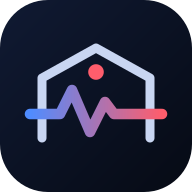
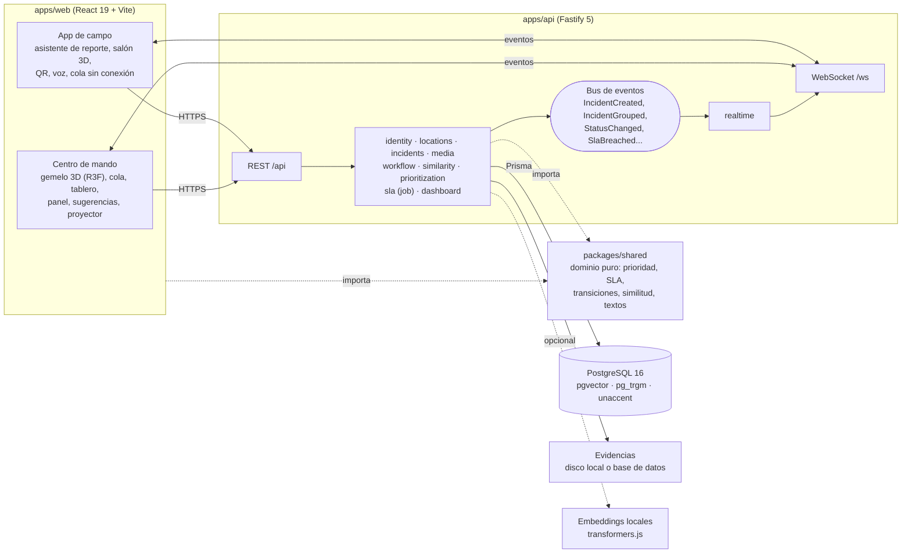

<div align="center">
  
  <h1>El Campus También Se Daña</h1>
  <p><b>Reporte y atención de daños del campus con gemelo digital 3D, prioridad ponderada, SLA con escalamiento y detección de duplicados</b><br/>Para la comunidad de UNIMINUTO: estudiantes que reportan, técnicos que atienden y supervisores que coordinan</p>

  
  
  
  
  
  
  <a href="LICENSE"></a>

  <p>
    <a href="docs/formula-y-similitud.md"><b>Fórmula y similitud</b></a> ·
    <a href="docs/guion-demo.md"><b>Guion de la demo</b></a> ·
    <a href="#arquitectura"><b>Arquitectura</b></a>
  </p>
</div>

<details>
<summary><b>English summary</b></summary>

*El Campus También Se Daña* ("The campus breaks too") is a facility-damage reporting and maintenance system for the UNIMINUTO university community in Colombia. Students report damage from their phones through a five-step wizard (room QR code, tapping the exact spot in a 3D model of the room, voice dictation, compressed photo, duplicate warning before submitting, offline queue). Maintenance staff work from a desktop command center built around a 3D digital twin of the campus, a priority queue, a status board, KPI dashboards, grouping suggestions and a projector mode.

Priority is an explainable weighted score over five variables (risk, damage type, similar reports, space impact and SLA age), related reports are detected by combining location, category, text (TF-IDF or optional local embeddings) and time, and an SLA job warns at 80% and escalates overdue incidents. It is a TypeScript monorepo: Fastify 5 + Prisma 6 on PostgreSQL 16 with pgvector, a React 19 + Vite + Tailwind v4 + React Three Fiber frontend, and a shared pure-domain package tested with Vitest that both the API and the phone preview use.
</details>

## Qué es

Un sistema para que la comunidad de UNIMINUTO reporte daños del campus (una gotera, un tomacorriente suelto, una luminaria fundida) y para que mantenimiento los atienda en orden, a tiempo y con evidencia. Resuelve tres cosas: que reportar sea rápido y preciso, hasta el punto exacto del salón; que varios reportes del mismo daño, escritos con otras palabras, se reconozcan como uno; y que mantenimiento sepa qué atender primero y cuánto lleva esperando cada caso, con una cola ordenada por una fórmula explicable y plazos con escalamiento automático.

Tiene dos interfaces independientes sobre la misma API:

- **Centro de mando (escritorio):** un gemelo digital 3D del campus con balizas por nivel de prioridad, la cola ordenada por puntaje, tablero por estados, panel de métricas, sugerencias de agrupación y un modo proyector para pantallas grandes.
- **App de campo (móvil):** reporte guiado en cinco pasos con QR del salón, salón 3D para tocar el punto exacto del daño, dictado por voz, foto comprimida, aviso de duplicados antes de enviar y cola sin conexión. Para técnicos y supervisores, una bandeja con gestos y evidencia antes y después.

## Funcionalidades

| Requisito | Cómo se resuelve |
|---|---|
| Registro de incidencias | Asistente móvil (`apps/web/src/mobile/report/`) y `POST /api/incidents`, validado con zod en `packages/shared/src/schemas.ts` |
| Prioridad ponderada con al menos tres variables | `computePriority` en `packages/shared/src/domain/priority.ts`: cinco variables con pesos, sin reglas por palabra clave. El desglose se ve en cada incidencia |
| Detección de incidencias relacionadas | `combineSimilarity` en `packages/shared/src/domain/similarity-score.ts`: ubicación, categoría, texto (TF-IDF o embeddings) y tiempo. Agrupa sola a partir de 75 % y sugiere desde 55 % |
| Escalamiento automático por SLA y marca de vencida | `apps/api/src/modules/sla/`: SLA de respuesta y de resolución por nivel, aviso al 80 %, sube un nivel al vencer y marca la incidencia como vencida |
| Estados con reglas por rol | `TRANSITION_RULES` en `packages/shared/src/domain/transition-policy.ts`. Pendiente, En proceso, Resuelto, Verificado. Un estudiante nunca marca Resuelto, y sin foto ni nota del arreglo no se puede resolver |
| Historial con tiempo por etapa | `StatusHistory` guarda la duración de cada etapa; se ve como línea de tiempo y barra de etapas en el detalle |
| Panel | `/panel`: vencidas, tiempo promedio y mediana de resolución por prioridad, espacios con más reportes, cumplimiento de SLA y mapa de calor por bloque y categoría |
| Tiempo real | Las vistas se actualizan por WebSocket (`/ws`) cuando se crea, agrupa, escala o cambia de estado una incidencia |
| Repetición | La barra inferior del gemelo digital reproduce la semana de datos a 1, 6 o 24 horas por segundo |

### Prioridad en una línea

```
P = 0,35 Riesgo + 0,25 Tipo de daño + 0,20 Reportes similares + 0,10 Impacto del espacio + 0,10 Antigüedad
```

Cada variable va de 0 a 100. **Crítica** desde 75, **Alta** desde 50, **Media** desde 25 y **Baja** por debajo. Al vencer un SLA, la incidencia sube un nivel encima de lo que da la fórmula, sin reemplazarla. La explicación completa, con ejemplos numéricos de prioridad, SLA y similitud, está en [`docs/formula-y-similitud.md`](docs/formula-y-similitud.md).

### Roles

| Rol | Qué hace |
|---|---|
| Estudiante | Reporta daños, se suma a reportes parecidos, sigue sus reportes y confirma cuando el arreglo quedó bien |
| Técnico | Toma casos desde la bandeja, sube la evidencia del arreglo y los marca como resueltos |
| Supervisor | Coordina desde el centro de mando, corrige el riesgo, decide las sugerencias de agrupación y verifica los arreglos |

## Arquitectura



- **Dominio compartido:** la misma función calcula la prioridad en la API y en la vista previa del celular, así que lo que el estudiante ve antes de enviar es lo que el sistema guarda. Las reglas viven en `packages/shared` como TypeScript puro y tienen pruebas en Vitest.
- **Módulos aislados:** ningún módulo de la API lee tablas de otro. Se comunican por su servicio público o por eventos (`IncidentCreated`, `IncidentGrouped`, `StatusChanged`, `SlaBreached`, ...). El módulo de tiempo real reenvía esos eventos por WebSocket.
- **Escalamiento seguro con varias réplicas:** la pasada de SLA toma filas con `FOR UPDATE SKIP LOCKED`.
- **Similitud híbrida:** TF-IDF sobre texto normalizado en español por defecto; con `SIMILARITY_EMBEDDINGS=on` se suma un modelo multilingüe local y los vectores se guardan en una columna `vector(384)` de pgvector.
- **3D con respaldo:** las escenas se cargan con `React.lazy`. Si el equipo no tiene GPU suficiente (según `detect-gpu`), se muestra un plano isométrico SVG con la misma información. Los edificios y el mobiliario se generan por código a partir de la base de datos.
- **Errores al usuario:** siempre `{ error, field? }` en español, nunca trazas.

## Stack tecnológico

| Capa | Tecnología |
|---|---|
| Frontend | React 19, Vite 7, Tailwind CSS 4, framer-motion, TanStack Query y Table, React Router 7, Radix UI, zustand, react-hook-form, Recharts |
| 3D | three.js, React Three Fiber 9, drei, `detect-gpu`; modelos optimizados con `gltf-transform` |
| Móvil | Lectura de QR con ZXing, Web Speech API para dictado, `browser-image-compression`, PWA con `vite-plugin-pwa` |
| Backend | Fastify 5 (helmet, CORS, JWT, rate limit, multipart, WebSocket, static), zod, bcryptjs, node-cron, sharp |
| Datos | PostgreSQL 16 con pgvector, `pg_trgm` y `unaccent`; Prisma 6 |
| Similitud | `natural` (TF-IDF y raíces en español); opcional `@huggingface/transformers` con `paraphrase-multilingual-MiniLM-L12-v2` |
| Calidad | Vitest, ESLint, Prettier, TypeScript estricto, hook de pre-commit y verificación de que no haya emojis |
| Infraestructura local | Docker Compose con `pgvector/pgvector:pg16` |

## Puesta en marcha

Requisitos: Node.js 20 o superior y Docker (para PostgreSQL con pgvector).

```bash
npm install
cp .env.example .env          # en Windows: copy .env.example .env
npm run db:up                 # Postgres en el puerto 5434
npm run db:migrate
npm run db:seed               # 2 sedes, 6 bloques, 38 espacios, 10 usuarios y unas 60 incidencias con una semana de historia
npm run dev                   # API con tsx watch y web con Vite HMR
```

Abre `http://localhost:5173`. Si en ese puerto ves otra aplicación (por un service worker viejo de otro proyecto), usa `http://127.0.0.1:5173`.

La vista se elige sola por tamaño de pantalla. Para forzarla agrega `?view=desktop`, `?view=mobile` o `?view=projector` a la URL; `?view=auto` vuelve al modo automático.

### Usuarios de prueba

Con `ALLOW_DEV_LOGIN=true` la pantalla de ingreso ofrece acceso rápido por rol. Las cuentas las crea `npm run db:seed` con la contraseña de demostración definida en `apps/api/prisma/seed.ts`.

| Rol | Correo |
|---|---|
| Supervisor | `supervisor@campus.edu.co` |
| Técnico | `tecnico1@campus.edu.co` a `tecnico3@campus.edu.co` |
| Estudiante | `estudiante1@campus.edu.co` a `estudiante6@campus.edu.co` |

### Probar desde un celular

`npm run dev:phone` sirve la web por HTTPS con un certificado local, necesario para la cámara (QR y fotos) y el dictado por voz. El celular debe estar en la misma red; el modo proyector y "Mis reportes" muestran un QR con la dirección correcta.

### Variables de entorno

Plantilla en [`.env.example`](.env.example); se validan con zod al arrancar (`apps/api/src/common/env.ts`).

| Variable | Uso |
|---|---|
| `DATABASE_URL` | Conexión a PostgreSQL |
| `NODE_ENV`, `PORT` | Modo y puerto de la API (`4000` por defecto) |
| `JWT_SECRET` | Firma de sesiones, 32 caracteres o más |
| `CORS_ORIGIN` | Orígenes permitidos, separados por coma |
| `ALLOW_DEV_LOGIN` | Acceso rápido por rol para la demo. Apagado fuera de la demo |
| `SLA_TIME_SCALE` | Reloj del SLA: `1` es tiempo real, `60` hace que una hora dure un minuto |
| `SIMILARITY_EMBEDDINGS` | Activa la similitud semántica local (requiere instalar `@huggingface/transformers` en `apps/api`) |
| `STORAGE_DRIVER`, `UPLOAD_DIR` | Evidencias en disco local o en la base de datos |
| `VITE_API_URL` | URL de la API para la web; vacía usa el proxy de Vite (`/api` y `/ws`) |

### Scripts

| Script | Qué hace |
|---|---|
| `npm run dev` | API y web con recarga en caliente |
| `npm run dev:phone` | Igual, con HTTPS para probar en el celular |
| `npm run simulate` | Simulador de reportes para la demo |
| `npm test` | Pruebas de dominio con Vitest |
| `npm run lint` | Verifica que no haya emojis y corre ESLint |
| `npm run typecheck` | TypeScript en todos los paquetes |
| `npm run build` | Build de producción de la web |
| `npm run db:seed` | Borra y vuelve a sembrar los datos de demo |
| `npm run db:studio` | Prisma Studio |
| `npm run models` | Optimiza los modelos 3D de `assets-src/` |

## Demo

- **Simulador:** con la API corriendo, `npm run simulate` envía un reporte cada 6 segundos como si fueran estudiantes. Varias personas reportan el mismo daño con otras palabras y en puntos cercanos del salón, así que la agrupación se ve en vivo. Opciones: `npm run simulate -- --interval 4 --count 20`.
- **SLA acelerado:** `SLA_TIME_SCALE=60` en `.env` hace que una hora de SLA dure un minuto; el job revisa cada 10 segundos. Reinicia la API después de cambiarlo.
- **Modo proyector:** `?view=projector` muestra el campus 3D a pantalla completa con lo más urgente, un ticker en vivo y un QR para reportar.
- **Repetición:** la barra inferior del gemelo digital reproduce la semana del seed a 1, 6 o 24 horas por segundo.

El guion paso a paso, con un plan B para cada falla posible, está en [`docs/guion-demo.md`](docs/guion-demo.md).

## Pruebas

```bash
npm test
```

Las pruebas de Vitest cubren el dominio compartido: fórmula de prioridad, puntaje de similitud, cálculo de SLA y política de transiciones por rol (`packages/shared/src/domain/*.test.ts`).

## Despliegue

Un solo servicio web: Fastify sirve el build de Vite y la API en `0.0.0.0:$PORT`, más una base PostgreSQL con la extensión pgvector.

```bash
npm ci --include=dev && npm run build && npm run db:deploy && npm run db:seed:once   # build
npm start                                                                            # inicio
```

`db:seed:once` solo carga los datos de demostración si la base está vacía, así que los despliegues siguientes conservan lo que se haya reportado. Se instalan las dependencias de desarrollo porque el servidor corre con `tsx` y el build usa Vite y Prisma.

Variables necesarias: `DATABASE_URL`, `JWT_SECRET` (32 caracteres o más), `NODE_ENV=production`, `CORS_ORIGIN` y `STORAGE_DRIVER=database`, porque el disco de plataformas como Render se borra en cada despliegue. `ALLOW_DEV_LOGIN` debe quedar apagado fuera de la demo.

## Estructura del repositorio

```
apps/api          Fastify 5 + Prisma + zod. Un módulo por dominio en src/modules/
  prisma/         Esquema, migraciones y datos de demostración
apps/web          React 19 + Vite + Tailwind v4 + framer-motion + React Three Fiber
  src/desktop/    Centro de mando
  src/mobile/     App de campo
  src/scenes/     Gemelo digital del campus y salones 3D
packages/shared   Dominio puro en TypeScript: prioridad, SLA, transiciones, similitud y textos
assets-src/       Modelos 3D originales (CC0) antes de optimizar
docs/             Fórmula y similitud, guion de la demo
```

## Autoría

<table>
  <tr>
    <td align="center"><a href="https://github.com/Joan-Mora"><br/><b>Darwin Joan Aveiga Mora</b></a><br/><sub>Arquitectura y desarrollo full stack</sub></td>
    <td align="center"><a href="https://github.com/MrRoar154"><br/><b>Julian Esteban Chavez Zamora</b></a><br/><sub>Colaborador</sub></td>
  </tr>
</table>

Desarrollado para la comunidad de UNIMINUTO. No usa el logo institucional de la universidad.

Los recursos de terceros (modelos 3D de Quaternius con licencia CC0, íconos de Lucide, fuentes con licencia OFL y bibliotecas de código abierto) se detallan en [`CREDITS.md`](CREDITS.md).

## Licencia

Copyright © 2026 Darwin Joan Aveiga Mora. **Todos los derechos reservados.**

Este repositorio es público para que el código pueda consultarse como parte de mi portafolio. Eso no concede permiso para copiarlo, reutilizarlo, modificarlo, distribuirlo ni presentarlo como trabajo propio. Los términos completos están en [`LICENSE`](LICENSE). Para cualquier uso, escribe a [darwin@abacore.co](mailto:darwin@abacore.co).

<div align="center">
<sub>Hecho por <a href="https://github.com/Joan-Mora">Darwin Aveiga</a> · <a href="https://abacore.co">Abacore S.A.S.</a></sub>
</div>
